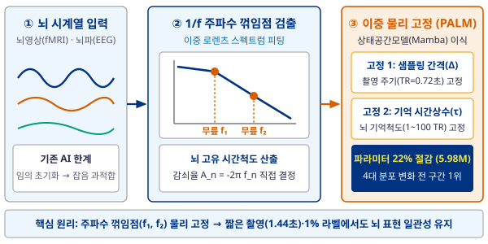
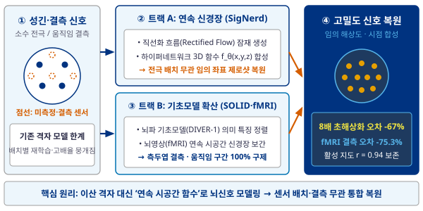
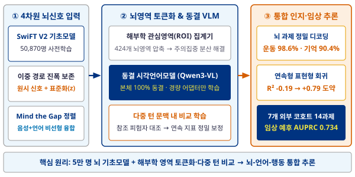

<!-- Slide 1: PIMSM / PALM -->

  

    
연구 1-4 (서울대 차지욱 교수팀) · 세부주제 1: 뇌 물리법칙 기반 인공지능

    <h1 class="slide-title">뇌 고유 리듬 이식 물리 정보 기반 뇌 동역학 모델 (PALM / 구 PIMSM)</h1>
  

  
담당: 배상윤 연구원 (서울대)

  <strong>핵심 요약:</strong> 기존 AI(단순 숫자열 학습 → 짧은 촬영 시 붕괴) &nbsp;➔&nbsp; <strong>뇌 주파수 꺾임점(무릎 주파수)에서 고유 기억 시간척도 추출·고정</strong> &nbsp;➔&nbsp; <strong>단축 촬영·1% 데이터에서도 고성능 유지</strong>

  

    

      핵심 개념도: 뇌 주파수 물리법칙 이식 상태공간모델
      약어 풀어쓰기 포함
    

    
  

  

    

      주요 정량 성과: 4대 분포 변화(Shift) 성능 비교
      인간 커넥톰 프로젝트(HCP) 1,086명
    

    <table class="res-table">
      <thead>
        <tr>
          <th>평가 과제 (임상·센서 제약)</th>
          <th>기존 최신 모델</th>
          <th>제안 모델 (PALM, 598만)</th>
          <th>개선 폭</th>
        </tr>
      </thead>
      <tbody>
        <tr class="hi">
          <td><strong>① 단축 촬영</strong> (1.44초, 2시점 관측)</td>
          <td>91.4% (표현유사도 0.73)</td>
          <td>93.3% (표현유사도 0.81)</td>
          <td>표현 일관성 <strong>+10.8%</strong></td>
        </tr>
        <tr class="hi">
          <td><strong>② 소수 라벨 전이</strong> (1% 라벨 학습)</td>
          <td>Mamba2 75.2%</td>
          <td>정확도 79.7% (±4.0%)</td>
          <td>정확도 <strong>+4.5%p</strong></td>
        </tr>
        <tr>
          <td><strong>③ 뇌 상태 교차</strong> (휴지기 → 운동)</td>
          <td>Mamba2 59.1%</td>
          <td>정확도 63.2% (±1.3%)</td>
          <td>정확도 <strong>+4.1%p</strong></td>
        </tr>
        <tr>
          <td><strong>④ 미관측 센서 외삽</strong> (기상 5천 곳)</td>
          <td>기초모델 오차(MSE) 0.40</td>
          <td>전 구간 1위 (오차 0.35)</td>
          <td>예측 오차 <strong>-15.2%</strong></td>
        </tr>
      </tbody>
    </table>
    

      

        <strong>선행 1 (다중주파수 기초모델, MBBN):</strong> 49,673명 주파수 분해 학습 · 자폐 분류 AUROC <strong>0.810</strong> (최대 <strong>+41.4%</strong>)
      

      

        <strong>선행 2 (물리 역변환 인과추론, INCAMA):</strong> 혈류지연·전극섞임 역변환 · 뇌파 인과 AUROC <strong>0.833</strong> (연산 <strong>2,000배</strong> 단축)
      

    

  

  
ICLR 2027 심사 중 <strong>본 연구 (PALM / 구 PIMSM):</strong> 논문 #39398 심사 중 · 사전공개본 <a href="https://arxiv.org/abs/2605.16351">arXiv:2605.16351</a> (11월 개정본 업데이트)

  
연계 논문 <strong>MBBN:</strong> <em>Communications Biology</em> 심사 중 (<a href="https://arxiv.org/abs/2503.23394">arXiv:2503.23394</a>) &nbsp;|&nbsp; <strong>INCAMA:</strong> <em>Nature Communications</em> 투고 준비 (<a href="https://arxiv.org/abs/2510.17318">arXiv:2510.17318</a>)

---

<!-- Slide 2: GINR -->

  

    
연구 1-4 (서울대 차지욱 교수팀) · 세부주제 2: 연속 시공간 뇌 표현 및 초해상도 복원

    <h1 class="slide-title">생성형 내재 신경 표현 기반 뇌신호 초해상화·결측 복원 (GINR: SigNerd &amp; SOLID)</h1>
  

  
담당: 이세빈 · 이태양 연구원 (서울대)

  <strong>핵심 요약:</strong> 장비별 뇌파 전극 차이·뇌영상 움직임 결측 &nbsp;➔&nbsp; <strong>연속 3D 시공간 함수(생성형 신경장) + 기초모델 정렬 확산</strong> &nbsp;➔&nbsp; <strong>8개 센서로 62채널 뇌파 복원 · 결측 뇌영상 재생</strong>

  

    

      핵심 개념도: 연속 신경장(SigNerd) + 기초모델 정렬 확산(SOLID)
      양대 상보적 복원 트랙
    

    
  

  

    

      주요 정량 성과: 뇌파 초해상화(2×~8×) 및 뇌영상 결측 복원
      정규화제곱오차(NMSE, 낮을수록 우수) · 상관계수(PCC)
    

    <table class="res-table">
      <thead>
        <tr>
          <th>모달리티 및 복원 과제</th>
          <th>기존 보간법 / 비교군</th>
          <th>제안 모델 (SigNerd / SOLID)</th>
          <th>개선 폭</th>
        </tr>
      </thead>
      <tbody>
        <tr class="hi">
          <td><strong>① 뇌파 8배 초해상화</strong> (8 → 62채널)</td>
          <td>구면보간(SSI) 오차 2.204</td>
          <td>SigNerd 오차 0.726 (상관 0.70)</td>
          <td>복원 오차 <strong>-67.1%</strong></td>
        </tr>
        <tr class="hi">
          <td><strong>② 뇌파 4배 초해상화</strong> (16 → 62채널)</td>
          <td>SSI 1.090 / TransINR 0.713</td>
          <td>SEED 0.643 / PhysioNet 0.497</td>
          <td>뇌-컴퓨터 분류 <strong>1위 (47%)</strong></td>
        </tr>
        <tr>
          <td><strong>③ 측두엽 전체 결측 복원</strong> (SEED-V)</td>
          <td>SSI 1.364 / 확산(SRGDiff) 0.922</td>
          <td>SOLID 오차 0.625 (상관 0.63)</td>
          <td>7개 설정 중 <strong>6개 세계 1위</strong></td>
        </tr>
        <tr>
          <td><strong>④ 뇌영상(fMRI) 움직임 결측 복원</strong></td>
          <td>스플라인 오차 4.26 (17% 폐기)</td>
          <td>fMRI-GINR 오차 1.05 (r = 0.94)</td>
          <td>오차 <strong>-75.3%</strong> · <strong>100% 구제</strong></td>
        </tr>
      </tbody>
    </table>
    

      

        <strong>트랙 A (순수 생성형 신경장, SigNerd):</strong> 미 브룩헤이븐(BNL) 공동연구 · 3D 전극 좌표 무관 제로샷 연속 뇌전위 생성
      

      

        <strong>트랙 B (기초모델 유도 확산, SOLID):</strong> 자체 뇌파 기초모델(DIVER-1) 의미 정렬 · 고주파 뇌파 생리학적 복원
      

    

  

  
ICLR 2027 심사 중 <strong>NeuroX-EEG (SOLID-EEG):</strong> 논문 #53005 심사 중 (이태양 1저자·이세빈 공저, 뇌파 기초모델 정렬 확산 초해상화)

  
투고 준비 <strong>NeuroX-Field (SigNerd):</strong> ICML 2027 준비 (이세빈 1저자·이태양 공저, SNU-BNL) &nbsp;|&nbsp; <strong>fMRI/dMRI GINR:</strong> <em>Nature Methods</em> 투고 준비

---

<!-- Slide 3: VLM & SwiFT V2 -->

  

    
연구 1-4 (서울대 차지욱 교수팀) · 세부주제 3: 뇌 기초모델 및 시각-언어-행동 정렬

    <h1 class="slide-title">시각언어모델 연계 뇌 해독 (BrainVLM) 및 대규모 뇌 기초모델 (SwiFT V2)</h1>
  

  
담당: 왕희환 · 최주빈 연구원 (서울대)

  <strong>핵심 요약:</strong> 수만 복셀 주의집중 분산·진폭 소실 &nbsp;➔&nbsp; <strong>424개 해부학 뇌영역 압축 + 다중 턴 비교(BrainVLM) + 5만 명 기초모델(SwiFT V2)</strong> &nbsp;➔&nbsp; <strong>인지·임상 예후 정밀 해독</strong>

  

    

      핵심 개념도: 대규모 뇌 기초모델 + 동결 시각언어모델 추론
      뇌신호 · 음성 · 언어 · 행동 정렬
    

    
  

  

    

      주요 정량 성과: 과제 해독 · 표현형 회귀 · 다중감각 · 임상 예후
      HCP 1,081명 · ABCD · 7개 외부 임상 코호트
    

    <table class="res-table">
      <thead>
        <tr>
          <th>세부 연구 및 평가 과제</th>
          <th>기존 뇌 기초모델 / 비교군</th>
          <th>제안 모델 (BrainVLM / SwiFT V2)</th>
          <th>개선 폭</th>
        </tr>
      </thead>
      <tbody>
        <tr class="hi">
          <td><strong>① 뇌 과제 해독</strong> (운동 5종 / 작업기억 8종)</td>
          <td>BrainLM 34.4% / 32.2%</td>
          <td>BrainVLM 98.6% / 90.4%</td>
          <td>정확도 <strong>약 3배 도약</strong></td>
        </tr>
        <tr class="hi">
          <td><strong>② 다중 턴 비교 표현형 회귀</strong> (ABCD)</td>
          <td>단일 턴 결정계수(R²) -0.19 (실패)</td>
          <td>3-턴 비교 R² +0.79 · 성별 97%</td>
          <td>참조 뇌 비교 <strong>정밀 보정</strong></td>
        </tr>
        <tr>
          <td><strong>③ 자연 발화 청취 뇌 반응 예측</strong></td>
          <td>단일모달 선형 결합 (음성/언어)</td>
          <td>음성+언어 비선형 정렬 (Mind the Gap)</td>
          <td>예측 상관 <strong>+17.9% 향상</strong></td>
        </tr>
        <tr>
          <td><strong>④ 7개 코호트 14개 임상·인지 과제</strong></td>
          <td>BrainLM(6.3억) 0.586</td>
          <td>SwiFT V2(900만) AUPRC 0.686</td>
          <td>임상 예후 <strong>0.734 (1위)</strong></td>
        </tr>
      </tbody>
    </table>
    

      

        <strong>BrainVLM 핵심 기전:</strong> 원시 진폭 + 표준화(z) 이중 경로 결합 → 부위별 진폭 손실 방지(운동 <strong>+24.5%p</strong>)
      

      

        <strong>SwiFT V2(5만 명) 뇌과학 검증:</strong> 어휘 과제 뇌 차폐 분석 → 좌반구 언어 네트워크 편측화(<strong>76%</strong>, 브로카 영역) 규명
      

    

  

  
ICLR 2027 심사 중 <strong>BrainVLM (CALIBRA-fMRI):</strong> 논문 #26688 심사 중 (왕희환 1저자, 해부학 영역 집계 및 다중 턴 비교 보정)

  
사전공개 · 투고 준비 <strong>Mind the Gap:</strong> <a href="https://arxiv.org/abs/2502.12771">arXiv:2502.12771</a> (한동엽·조윤주) &nbsp;|&nbsp; <strong>SwiFT V2 (5만 명 기초모델):</strong> <em>Nature Communications</em> 준비 (최주빈·왕희환, 선행 <a href="https://arxiv.org/abs/2307.05916">arXiv:2307.05916</a>)

